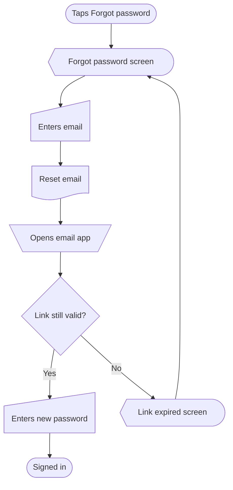
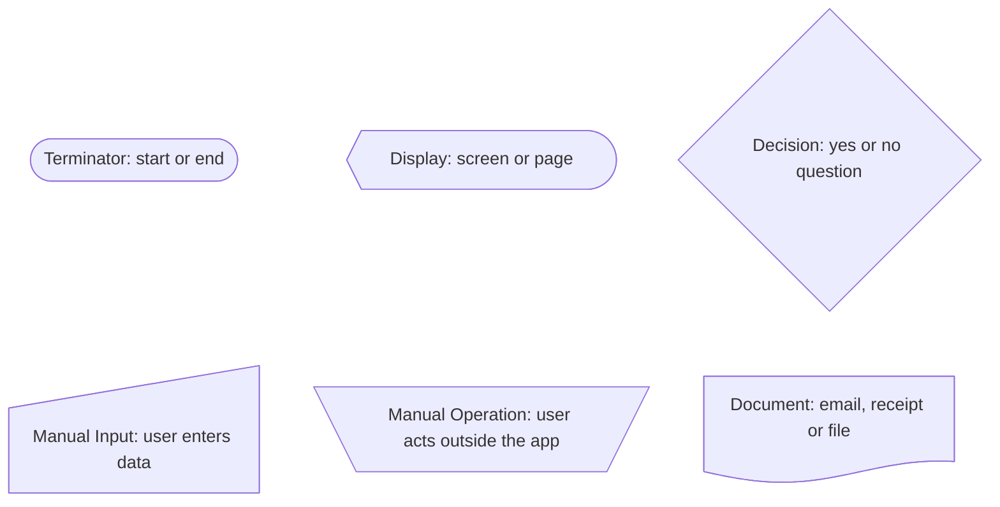

# mermaid-userflow

An agent skill that draws user flows as Mermaid flowcharts. Login, signup, password reset, onboarding, checkout, and the empty and error branches around them.

Every node uses a fixed shape for its type, taken from the standard flowchart symbols (the same set as the Figma flowchart symbols). A screen always looks like a screen, a decision always looks like a decision, so any flow reads the same way. Each flow comes with a legend of only the shapes it uses.





It is plain markdown plus one optional Python script, so it works with any agent that can read files.

## Shapes

| Name | Used for | Prefix | Mermaid shape |
|---|---|---|---|
| Terminator | start or end | `start`, `exit` | `stadium` |
| Display | screen or page | `scr` | `curv-trap` |
| Process | step or action | `act` | `rect` |
| Decision | yes or no question | `dec` | `diam` |
| Manual Input | user enters data | `in` | `sl-rect` |
| Manual Operation | user acts outside the app | `man` | `trap-t` |
| Predefined Process | subflow or other flow | `sub` | `fr-rect` |
| Preparation | setup before a step | `prep` | `hex` |
| Delay | waiting | `wait` | `delay` |
| Data (I/O) | data in or out | `io` | `lean-r` |
| Database | saved records | `db` | `cyl` |
| Stored Data | any stored data | `store` | `bow-rect` |
| Internal Storage | session or cache | `mem` | `win-pane` |
| Direct Access Storage | files on the device | `disk` | `h-cyl` |
| Document | email, receipt or file | `doc` | `doc` |
| Multiple Documents | several documents | `mdoc` | `docs` |
| Paper Tape | physical item | `tape` | `flag` |
| Merge | two paths rejoin | `merge` | `flip-tri` |
| Summing Junction | three or more paths rejoin | `sum` | `cross-circ` |
| Connector | jump within the flow | `con` | `circle` |
| Curly Brace Note | comment on a node | `note` | `brace` |

Every shape, drawn as a legend, with details and syntax: [references/shapes.md](references/shapes.md).

## Legend

Every flow gets a legend: a second Mermaid block listing only the shapes that flow uses, each drawn as the real shape and labelled `Name: used for`. It's laid out as a 3 column grid. When several flows go together, in one reply or one saved file, they share one legend at the start.

## Requirements

The shapes use Mermaid's `id@{ shape: ... }` syntax, which needs Mermaid 11.3 or newer. GitHub and [mermaid.live](https://mermaid.live) render it. Tools on an older Mermaid fail the whole diagram with a syntax error.

## Folder structure

```
SKILL.md                  rules, shapes, legend, workflow, validation, library map
references/shapes.md      every shape: Name, Used for, prefix, syntax,
                          legend entry, plus a legend of all 21
references/diagrams.md    6 diagrams: login, signup, password reset,
                          onboarding, checkout, empty and error branches
references/flows.md       a saved file with 3 linked flows and a shared legend
scripts/validate.py       optional validator
```

## Install

The skill folder should be named `mermaid-userflow`, matching the `name` in `SKILL.md`.

**Claude Code**, for all your projects:

```bash
git clone https://github.com/yoursharif/mermaid-userflow-diagram.git ~/.claude/skills/mermaid-userflow
```

Or for one project, clone into `.claude/skills/mermaid-userflow` inside that repo.

**Claude apps**: download the repo as a zip and upload it under Settings > Capabilities > Skills.

**Any other agent**: put the folder somewhere the agent can read and point it at `SKILL.md`, for example from `AGENTS.md` or your system prompt:

```
When asked for a user flow, follow mermaid-userflow/SKILL.md.
```

`SKILL.md` tells the agent which reference files to open for each kind of request.

## Validate

Requires Python 3, no dependencies.

```bash
python3 scripts/validate.py references/*.md
```

For a markdown file it checks every fenced block labelled `mermaid`, and that every flow has its legend. Any other file, or `-` for stdin, is treated as one flow. It exits non zero on any error.

Checks:

1. A flow starts with `flowchart TD` or `flowchart LR`.
2. Every node uses `id@{ shape: x, label: "..." }` with the shape its ID prefix requires.
3. IDs are a known prefix plus a PascalCase name.
4. Every edge is `a --> b`, `a -->|Label| b` or `noteX -.- b`, one per line.
5. Every node in an edge is defined, all nodes come before edges.
6. No orphan nodes and no dead ends. At least one start node.
7. Every decision has two or more labelled arrows out.
8. Connectors come in pairs, merge and junction labels are one space.
9. Every flow has a legend right after it, or one shared legend before all flows.
10. A legend lists exactly the shapes used, in table order, labelled `Name: used for`, linked as a 3 column grid.
11. In a saved file, the shared legend sits under the title and flow headings are numbered 1, 2, 3 with one flow each.

Run it after any edit to the references. Every block in this repo passes.

## License

[CC BY-NC-ND 4.0](https://creativecommons.org/licenses/by-nc-nd/4.0/). Copyright (c) 2026 Md Shariful Islam Khan.

- You can install and use the skill, and share unchanged copies, with credit.
- You can't sell it or use it in a paid product.
- You can't share modified versions.

Full terms in [LICENSE](LICENSE).
