# Diagrams

Common user flows, ready to adapt. Start from the closest one, rename the nodes for the product, and cut what the request doesn't need. Each diagram shows the happy path plus its usual error and edge branches, followed by its legend.

Read `shapes.md` first. When you cut nodes, cut their legend entries too if no other node uses that shape.

## Login

Email and password sign in, with wrong password, lockout, forgot password and sign up exits.

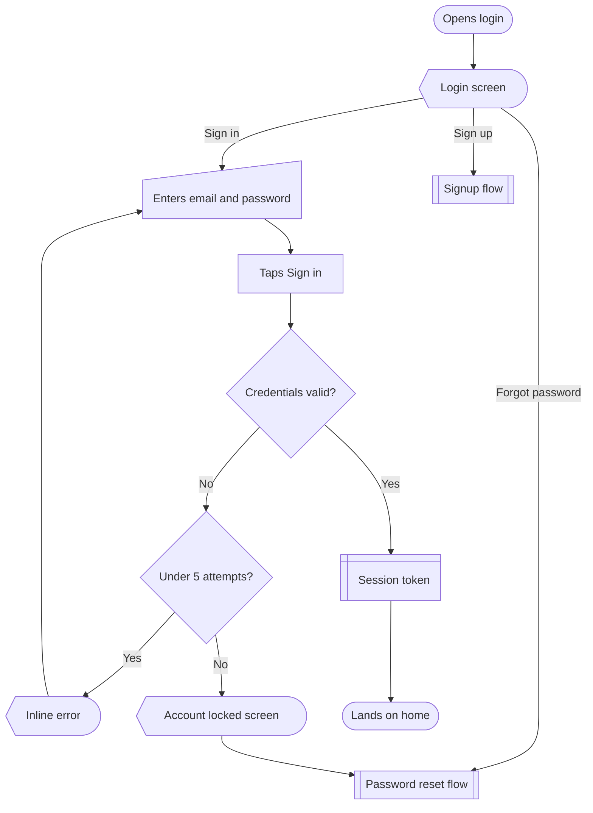

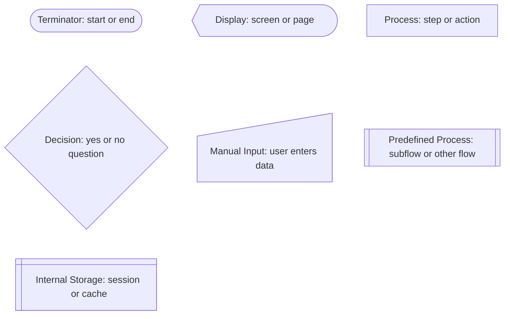

## Signup

Email sign up with an existing account check, password rules and email verification.

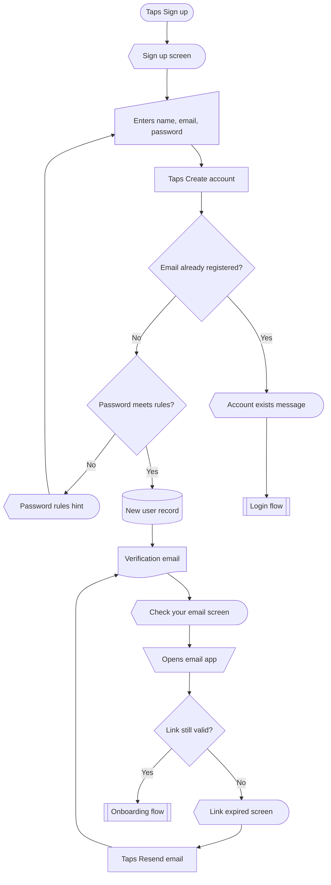

## Password reset

Reset by email link. The same confirmation shows whether or not the email is registered, so the screen never reveals who has an account.

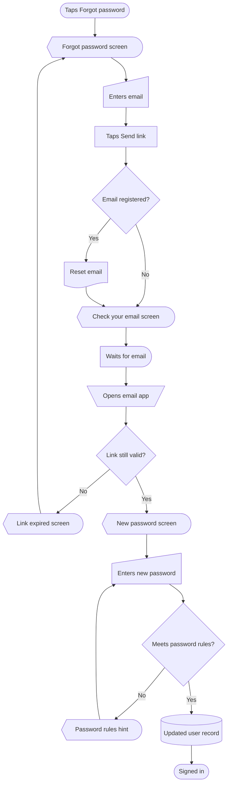

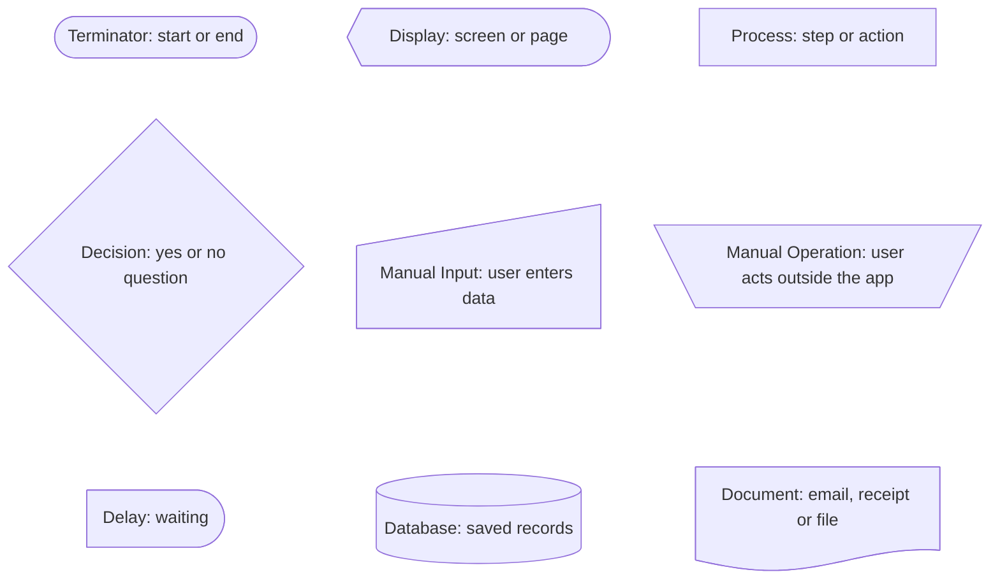

## Onboarding

First run after sign up: optional tour, permission prompt, a short profile step and a sample project so home isn't empty.

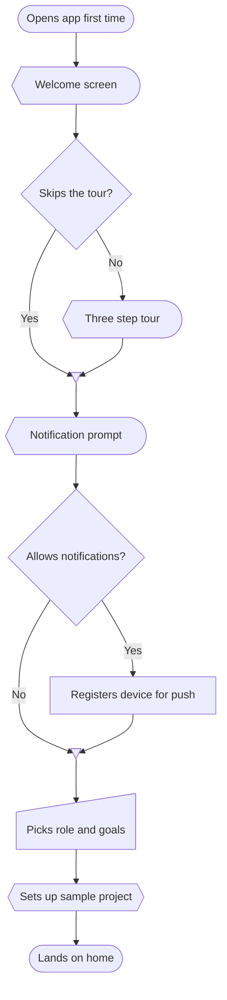

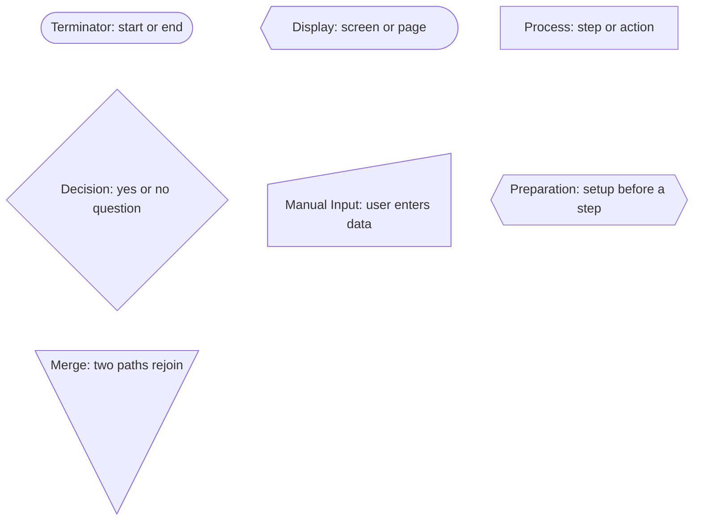

## Checkout

Cart to confirmation, with guest checkout, saved address and card, bank check and a declined card.

```mermaid
flowchart TD
  startCart@{ shape: stadium, label: "Taps Checkout" }
  decSignedIn@{ shape: diam, label: "Signed in?" }
  decGuest@{ shape: diam, label: "Continues as guest?" }
  inGuestEmail@{ shape: sl-rect, label: "Enters email" }
  subLogin@{ shape: fr-rect, label: "Login flow" }
  mergeAuth@{ shape: flip-tri, label: " " }
  prepAddress@{ shape: hex, label: "Prefills saved address" }
  scrShipping@{ shape: curv-trap, label: "Shipping step" }
  inAddress@{ shape: sl-rect, label: "Confirms or edits address" }
  scrPayment@{ shape: curv-trap, label: "Payment step" }
  decSavedCard@{ shape: diam, label: "Uses saved card?" }
  inCard@{ shape: sl-rect, label: "Enters card details" }
  mergeCard@{ shape: flip-tri, label: " " }
  actPlace@{ shape: rect, label: "Taps Place order" }
  ioCharge@{ shape: lean-r, label: "Charges card" }
  waitBank@{ shape: delay, label: "Waits for bank check" }
  decPaid@{ shape: diam, label: "Payment approved?" }
  scrDeclined@{ shape: curv-trap, label: "Card declined message" }
  dbOrder@{ shape: cyl, label: "New order record" }
  docReceipt@{ shape: doc, label: "Receipt email" }
  scrConfirm@{ shape: curv-trap, label: "Order confirmation" }
  exitPlaced@{ shape: stadium, label: "Order placed" }

  startCart --> decSignedIn
  decSignedIn -->|Yes| mergeAuth
  decSignedIn -->|No| decGuest
  decGuest -->|Yes| inGuestEmail
  decGuest -->|No| subLogin
  inGuestEmail --> mergeAuth
  mergeAuth --> prepAddress
  prepAddress --> scrShipping
  scrShipping --> inAddress
  inAddress --> scrPayment
  scrPayment --> decSavedCard
  decSavedCard -->|Yes| mergeCard
  decSavedCard -->|No| inCard
  inCard --> mergeCard
  mergeCard --> actPlace
  actPlace --> ioCharge
  ioCharge --> waitBank
  waitBank --> decPaid
  decPaid -->|No| scrDeclined
  decPaid -->|Yes| dbOrder
  scrDeclined --> scrPayment
  dbOrder --> docReceipt
  docReceipt --> scrConfirm
  scrConfirm --> exitPlaced
```

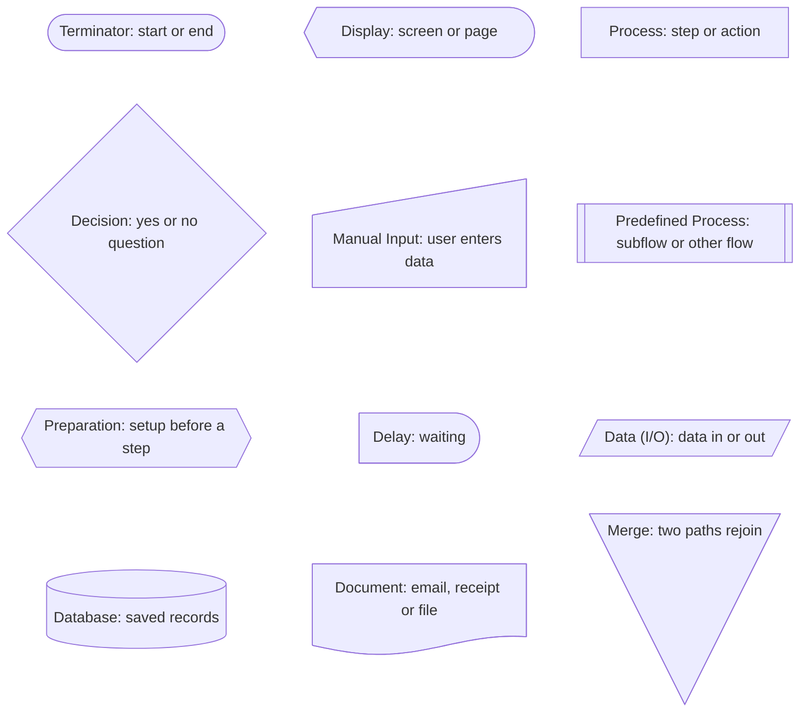

## Empty and error branches

Any screen that loads data. Loading, success, empty, offline and server error, with retry. Add these branches to any flow where a screen fetches something.

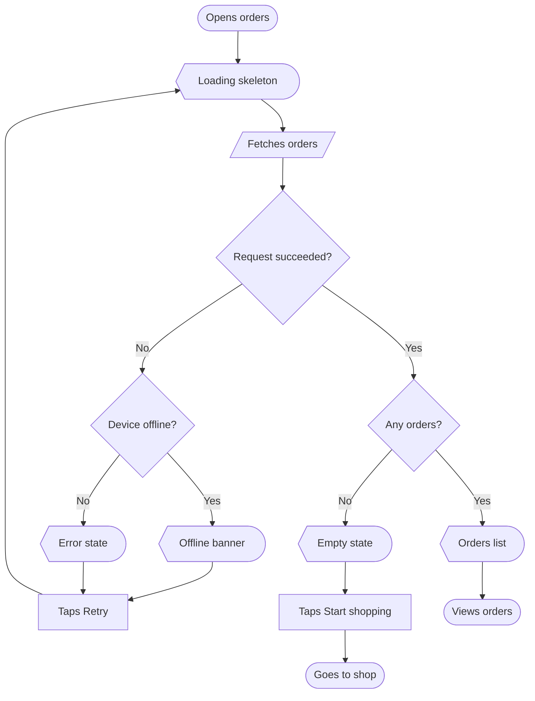

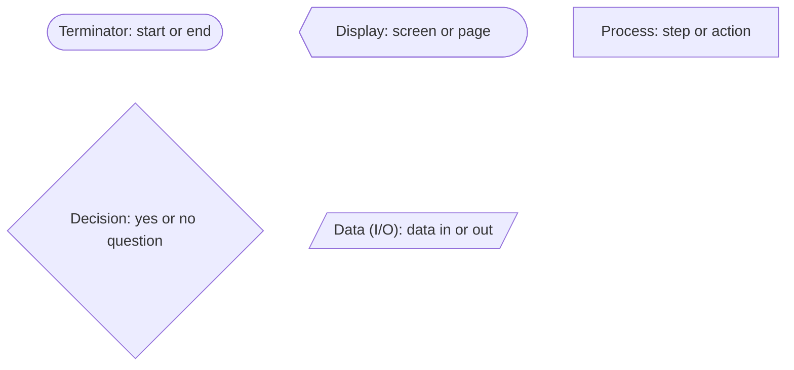
