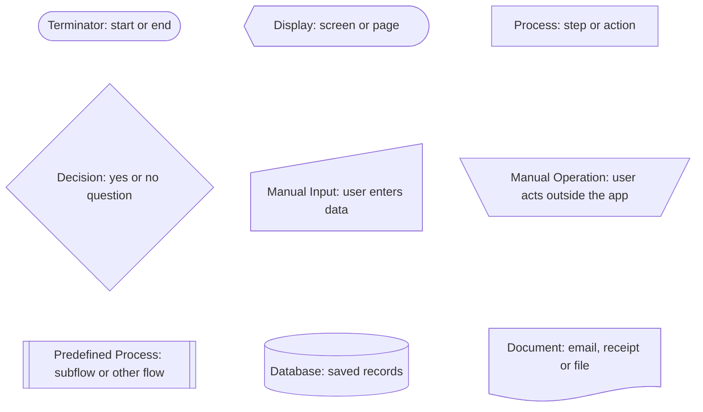
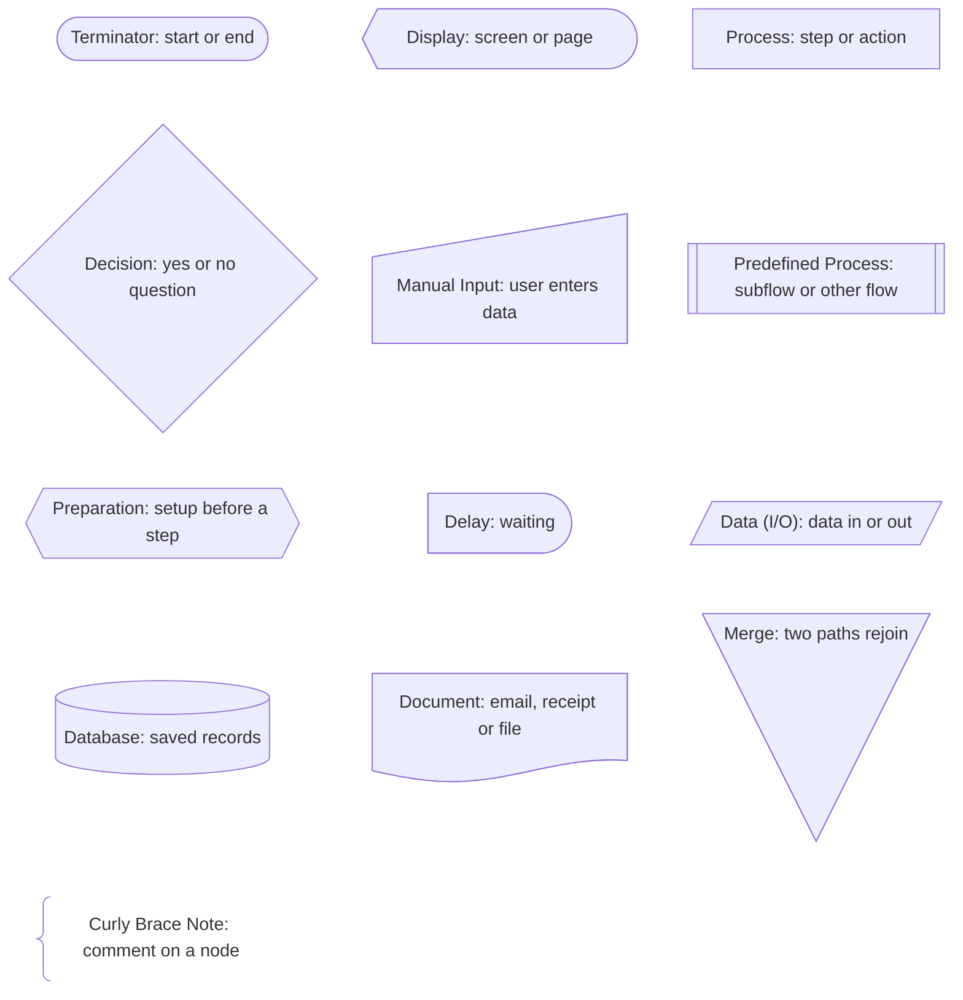

# Diagrams

Two complete single-flow examples, each followed by its legend. Use them as models for structure, branching and naming: rename the nodes for the product and cut what the request doesn't need.

Read `shapes.md` first. Add notes only when the user asks; the one in Checkout is there to show the syntax. When you cut nodes, cut their legend entries too if no other node uses that shape.

## Signup

Email sign up with an existing account check, password rules and email verification.

## Checkout

Cart to confirmation, with guest checkout, saved address and card, bank check and a declined card.

```mermaid
flowchart TD
  startCart@{ shape: stadium, label: "Taps Checkout" }
  decSignedIn@{ shape: diam, label: "Signed in?" }
  decGuest@{ shape: diam, label: "Continues as guest?" }
  inGuestEmail@{ shape: sl-rect, label: "Enters email" }
  subLogin@{ shape: fr-rect, label: "Login flow" }
  mergeAuth@{ shape: flip-tri, label: " " }
  prepAddress@{ shape: hex, label: "Prefills saved address" }
  scrShipping@{ shape: curv-trap, label: "Shipping step" }
  inAddress@{ shape: sl-rect, label: "Confirms or edits address" }
  scrPayment@{ shape: curv-trap, label: "Payment step" }
  decSavedCard@{ shape: diam, label: "Uses saved card?" }
  inCard@{ shape: sl-rect, label: "Enters card details" }
  mergeCard@{ shape: flip-tri, label: " " }
  actPlace@{ shape: rect, label: "Taps Place order" }
  ioCharge@{ shape: lean-r, label: "Charges card" }
  waitBank@{ shape: delay, label: "Waits for bank check" }
  noteBank@{ shape: brace, label: "May open<br>the bank app" }
  decPaid@{ shape: diam, label: "Payment approved?" }
  scrDeclined@{ shape: curv-trap, label: "Card declined message" }
  dbOrder@{ shape: cyl, label: "New order record" }
  docReceipt@{ shape: doc, label: "Receipt email" }
  scrConfirm@{ shape: curv-trap, label: "Order confirmation" }
  exitPlaced@{ shape: stadium, label: "Order placed" }

  startCart --> decSignedIn
  decSignedIn -->|Yes| mergeAuth
  decSignedIn -->|No| decGuest
  decGuest -->|Yes| inGuestEmail
  decGuest -->|No| subLogin
  inGuestEmail --> mergeAuth
  mergeAuth --> prepAddress
  prepAddress --> scrShipping
  scrShipping --> inAddress
  inAddress --> scrPayment
  scrPayment --> decSavedCard
  decSavedCard -->|Yes| mergeCard
  decSavedCard -->|No| inCard
  inCard --> mergeCard
  mergeCard --> actPlace
  actPlace --> ioCharge
  ioCharge --> waitBank
  waitBank --> decPaid
  noteBank -.- waitBank
  decPaid -->|No| scrDeclined
  decPaid -->|Yes| dbOrder
  scrDeclined --> scrPayment
  dbOrder --> docReceipt
  docReceipt --> scrConfirm
  scrConfirm --> exitPlaced
```

