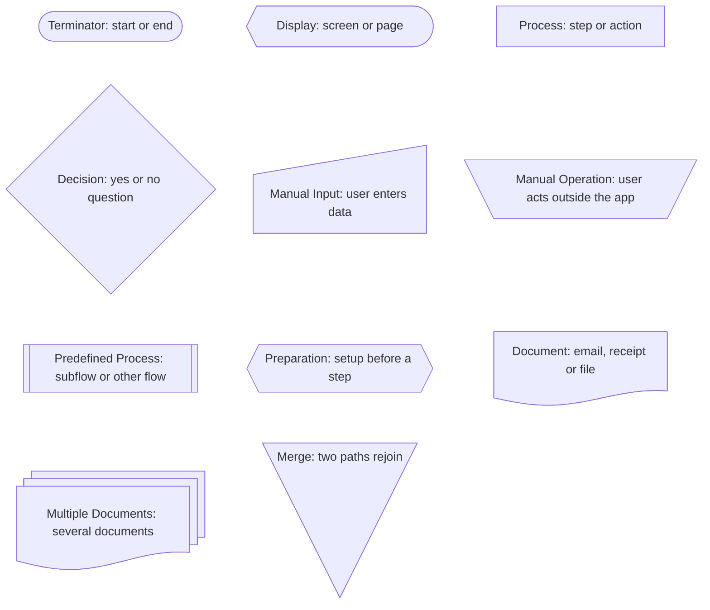
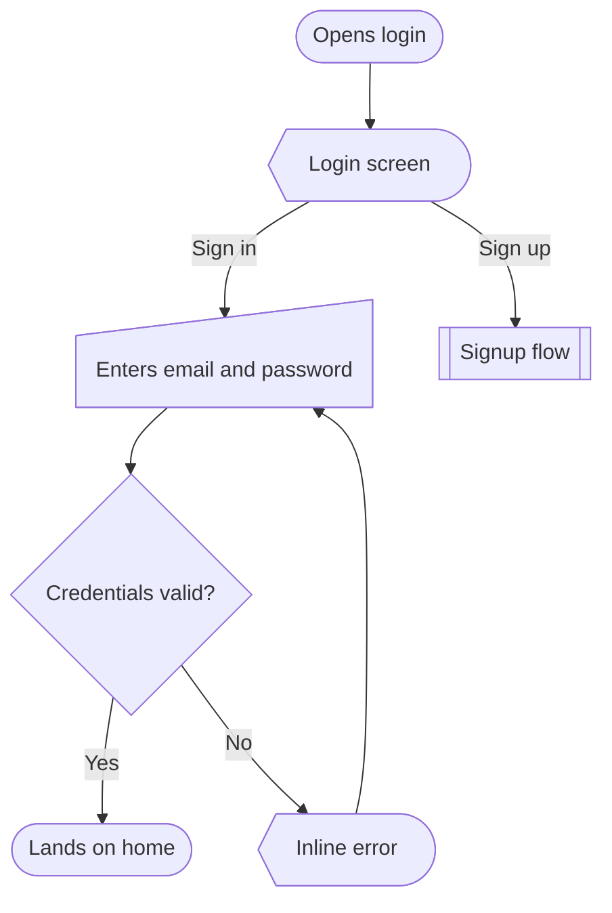
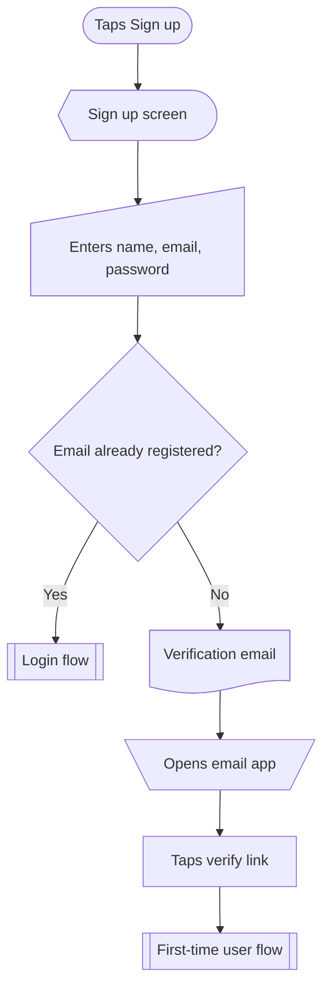
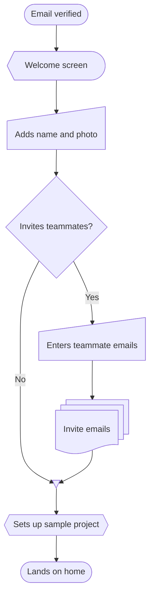

# Flows

Several flows together: in a reply, or saved as one file. Follow Multiple flows and Saving to a file in `SKILL.md`.

Both share one legend at the start, listing every shape used across all the flows. In a reply:

```
Auth flows for a recipe app.
(shared legend block)

**1. Login**: returning user signs in.
(mermaid block)

**2. Signup**: new user creates an account.
(mermaid block)
```

In a saved file, the shared legend sits under the `#` title, and each flow gets a numbered `##` heading and one short line instead of the bold line. Link the flows with `sub` nodes named after each other, so a reader can follow one into the next.

Below the line is a complete saved file, `auth.md`, exactly as it should be written.

---

# Auth



## 1. Login

Returning user signs in with email and password.



## 2. Signup

New user creates an account and verifies their email.



## 3. First-time user

Verified user sets up their profile and lands on a home that isn't empty.


