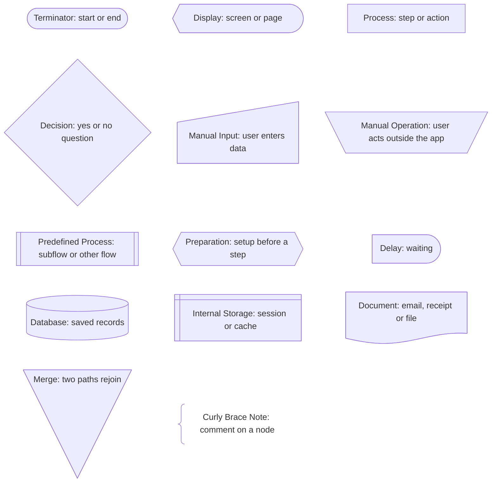
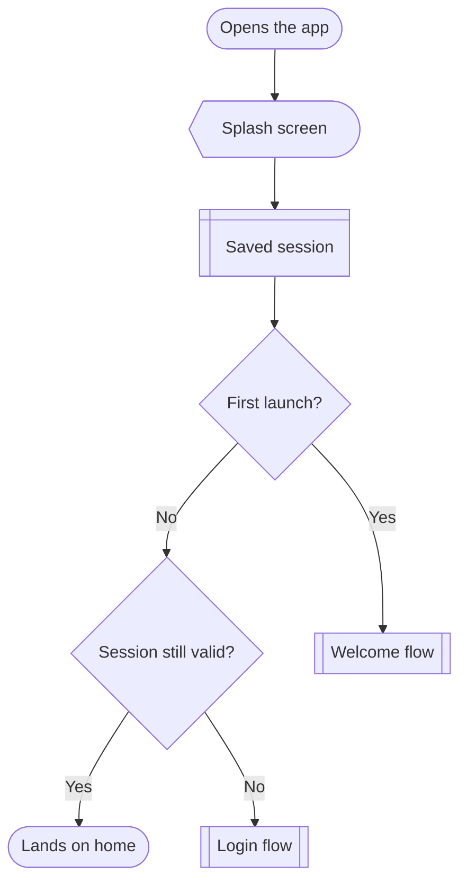
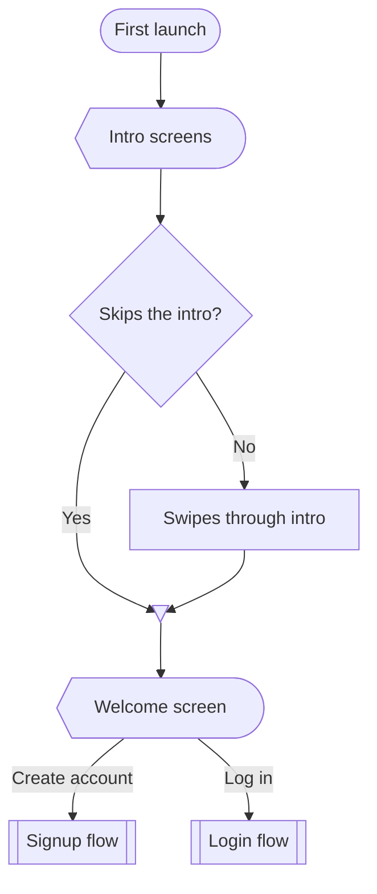
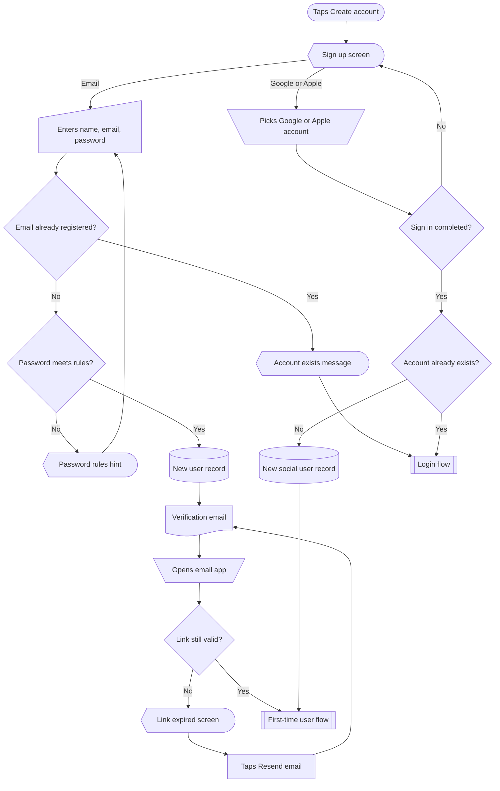
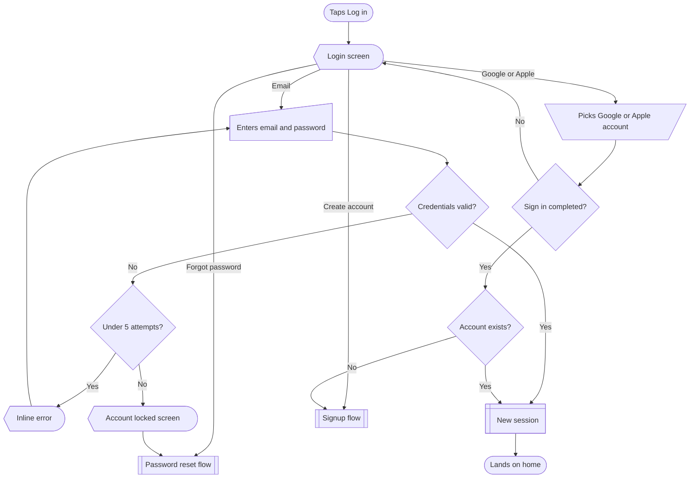
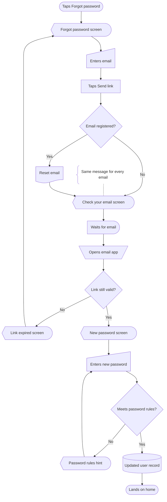
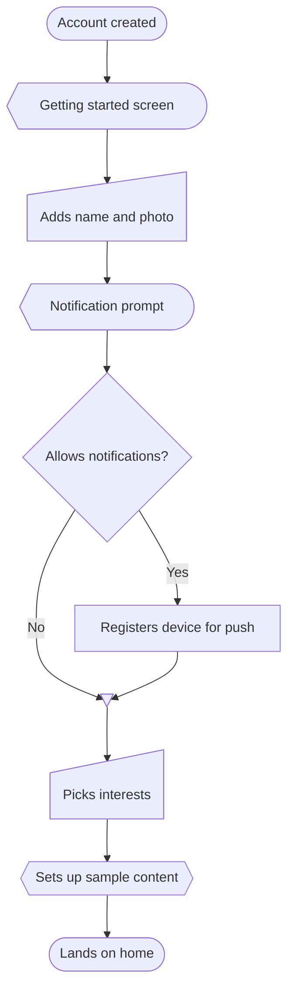

# Flows

Several flows together: in a reply, or saved as one file. Follow Multiple flows and Saving to a file in `SKILL.md`.

Both share one legend at the start, listing every shape used across all the flows. In a reply:

```
Onboarding flows for a recipe app.
(shared legend block)

**1. App launch**: routes first-time and returning users.
(mermaid block)

**2. Welcome**: intro, then Create account or Log in.
(mermaid block)
```

In a saved file, the shared legend sits under the `#` title, and each flow gets a numbered `##` heading and one short line instead of the bold line. Link the flows with `sub` nodes named after each other, so a reader can follow one into the next.

Below the line is a complete saved file, `onboarding.md`, exactly as it should be written. It covers everything from first launch to the home screen in 6 linked flows. The note in Password reset is there to show the syntax; add notes only when the user asks.

---

# Onboarding



## 1. App launch

Every launch: first-time users go to Welcome, returning users go home or log in.



## 2. Welcome

First-time user sees the intro, then picks Create account or Log in.



## 3. Signup

New user signs up with email and verifies it, or continues with Google or Apple.



## 4. Login

Returning user logs in with email or Google or Apple, with wrong password and lockout branches.



## 5. Password reset

User resets a forgotten password by email link. A note marks that the same message shows whether or not the email is registered.



## 6. First-time user

New user sets up their profile and notifications, then lands on a home that isn't empty.


