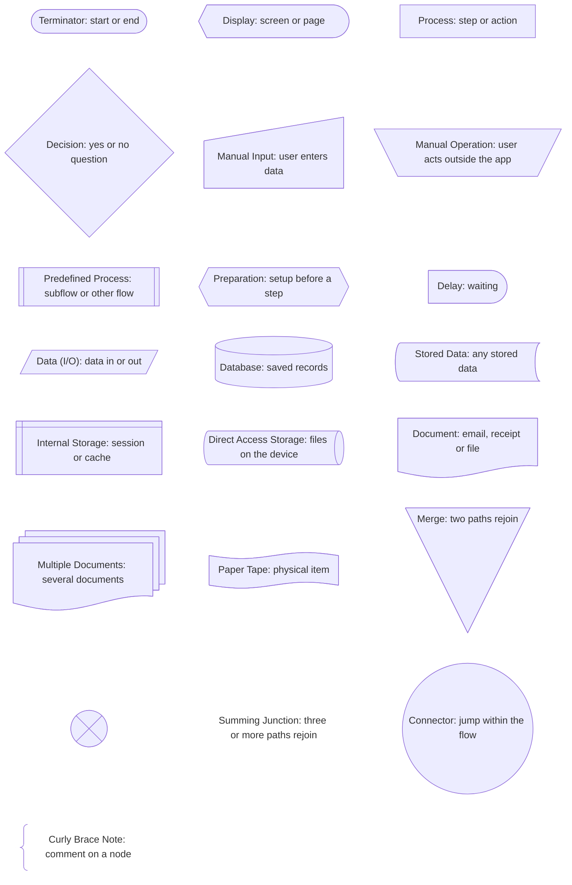

# Shapes

Every node type: its Name (the flowchart symbol), what it's Used for, its ID prefix, its Mermaid shape, a node example and its legend entry. The legend entry is always `Name: used for`, exactly as written here.

Full examples of these shapes in real flows are in `diagrams.md`.

## All shapes

Every shape at once, as a legend. A real legend lists only the shapes its flow uses.



## Core shapes

Most flows need only these.

### Terminator

- **Used for:** start or end
- **Prefix:** `start`, `exit`. **Mermaid shape:** `stadium`

Where a flow begins and where it ends. A flow can have several exits, one per outcome. A start node has no arrows in, an exit node has no arrows out.

```
startApp@{ shape: stadium, label: "Opens app" }
exitHome@{ shape: stadium, label: "Lands on home" }
lgTerminator@{ shape: stadium, label: "Terminator: start or end" }
```

### Display

- **Used for:** screen or page
- **Prefix:** `scr`. **Mermaid shape:** `curv-trap`

Anything the user sees: a screen, page, modal, sheet, toast or banner. Name it with a noun.

```
scrLogin@{ shape: curv-trap, label: "Login screen" }
lgDisplay@{ shape: curv-trap, label: "Display: screen or page" }
```

### Process

- **Used for:** step or action
- **Prefix:** `act`. **Mermaid shape:** `rect`

One step, by the user or the system: tap, submit, validate, send. Start the label with a verb.

```
actSubmit@{ shape: rect, label: "Taps Sign in" }
lgProcess@{ shape: rect, label: "Process: step or action" }
```

### Decision

- **Used for:** yes or no question
- **Prefix:** `dec`. **Mermaid shape:** `diam`

A question that splits the flow. End the label with a question mark. At least two arrows out, every one labelled.

```
decValid@{ shape: diam, label: "Valid credentials?" }
lgDecision@{ shape: diam, label: "Decision: yes or no question" }
```

### Manual Input

- **Used for:** user enters data
- **Prefix:** `in`. **Mermaid shape:** `sl-rect`

The user types or picks values: form fields, pickers, codes, card details.

```
inEmail@{ shape: sl-rect, label: "Enters email" }
lgManualInput@{ shape: sl-rect, label: "Manual Input: user enters data" }
```

### Predefined Process

- **Used for:** subflow or other flow
- **Prefix:** `sub`. **Mermaid shape:** `fr-rect`

A flow drawn somewhere else. Use it to link flows to each other and to keep big flows readable. It can end a path. It replaces the Off-Page Link symbol, which Mermaid can't draw.

```
subSignup@{ shape: fr-rect, label: "Signup flow" }
lgPredefinedProcess@{ shape: fr-rect, label: "Predefined Process: subflow or other flow" }
```

## Situational shapes

Use these when they say something the core shapes can't.

### Manual Operation

- **Used for:** user acts outside the app
- **Prefix:** `man`. **Mermaid shape:** `trap-t`

The user does something outside the product: opens their email, checks their phone, scans a card.

```
manOpenEmail@{ shape: trap-t, label: "Opens email app" }
lgManualOperation@{ shape: trap-t, label: "Manual Operation: user acts outside the app" }
```

### Preparation

- **Used for:** setup before a step
- **Prefix:** `prep`. **Mermaid shape:** `hex`

Setup the system does before a step: prefill a form, load a saved cart, start a session.

```
prepPrefill@{ shape: hex, label: "Prefills saved address" }
lgPreparation@{ shape: hex, label: "Preparation: setup before a step" }
```

### Delay

- **Used for:** waiting
- **Prefix:** `wait`. **Mermaid shape:** `delay`

Waiting on something: an email to arrive, a payment to process, a timer to run out.

```
waitEmail@{ shape: delay, label: "Waits for email" }
lgDelay@{ shape: delay, label: "Delay: waiting" }
```

### Data (I/O)

- **Used for:** data in or out
- **Prefix:** `io`. **Mermaid shape:** `lean-r`

Data crossing a boundary: an API call, an upload, an import or export.

```
ioUpload@{ shape: lean-r, label: "Uploads photo" }
lgDataIO@{ shape: lean-r, label: "Data (I/O): data in or out" }
```

### Database

- **Used for:** saved records
- **Prefix:** `db`. **Mermaid shape:** `cyl`

Structured records saved or read: a user, an order, a subscription.

```
dbUser@{ shape: cyl, label: "User record" }
lgDatabase@{ shape: cyl, label: "Database: saved records" }
```

### Stored Data

- **Used for:** any stored data
- **Prefix:** `store`. **Mermaid shape:** `bow-rect`

Data kept somewhere when the kind of storage doesn't matter: a saved draft, preferences.

```
storeDraft@{ shape: bow-rect, label: "Saved draft" }
lgStoredData@{ shape: bow-rect, label: "Stored Data: any stored data" }
```

### Internal Storage

- **Used for:** session or cache
- **Prefix:** `mem`. **Mermaid shape:** `win-pane`

Temporary state the product holds while it runs: session, cache, local storage.

```
memSession@{ shape: win-pane, label: "Session token" }
lgInternalStorage@{ shape: win-pane, label: "Internal Storage: session or cache" }
```

### Direct Access Storage

- **Used for:** files on the device
- **Prefix:** `disk`. **Mermaid shape:** `h-cyl`

Files on the user's device: photos, downloads, documents.

```
diskPhotos@{ shape: h-cyl, label: "Photo library" }
lgDirectAccessStorage@{ shape: h-cyl, label: "Direct Access Storage: files on the device" }
```

### Document

- **Used for:** email, receipt or file
- **Prefix:** `doc`. **Mermaid shape:** `doc`

One document sent to or made for the user: email, receipt, invoice, PDF.

```
docReceipt@{ shape: doc, label: "Receipt email" }
lgDocument@{ shape: doc, label: "Document: email, receipt or file" }
```

### Multiple Documents

- **Used for:** several documents
- **Prefix:** `mdoc`. **Mermaid shape:** `docs`

Several documents at once: monthly statements, a batch of invoices, attachments.

```
mdocStatements@{ shape: docs, label: "Monthly statements" }
lgMultipleDocuments@{ shape: docs, label: "Multiple Documents: several documents" }
```

### Paper Tape

- **Used for:** physical item
- **Prefix:** `tape`. **Mermaid shape:** `flag`

A physical item handed to or from the user: printed ticket, boarding pass, card. Rare in digital flows.

```
tapeTicket@{ shape: flag, label: "Printed ticket" }
lgPaperTape@{ shape: flag, label: "Paper Tape: physical item" }
```

## Joining shapes

### Merge

- **Used for:** two paths rejoin
- **Prefix:** `merge`. **Mermaid shape:** `flip-tri`

Two paths rejoin before the next step. In a flow its label is always one space, `" "`, so the triangle stays small.

```
mergeCard@{ shape: flip-tri, label: " " }
actUseCard --> mergeCard
inCard --> mergeCard
mergeCard --> actPlace
lgMerge@{ shape: flip-tri, label: "Merge: two paths rejoin" }
```

### Summing Junction

- **Used for:** three or more paths rejoin
- **Prefix:** `sum`. **Mermaid shape:** `cross-circ`

Three or more paths rejoin. In a flow its label is always one space, `" "`. Mermaid draws no text inside a crossed circle, so its legend entry is two nodes: the circle, then a `text` node with the label.

```
sumMethods@{ shape: cross-circ, label: " " }
lgSummingJunction@{ shape: cross-circ, label: " " }
lgSummingJunctionText@{ shape: text, label: "Summing Junction: three or more paths rejoin" }
```

### Connector

- **Used for:** jump within the flow
- **Prefix:** `con`. **Mermaid shape:** `circle`

A jump inside the same flow, to avoid a long crossing arrow. Always a pair with the same 1 or 2 character label: one takes arrows in, the other sends them out. For a jump to another flow, use Predefined Process.

```
conAOut@{ shape: circle, label: "A" }
conAIn@{ shape: circle, label: "A" }
inGuestEmail --> conAOut
conAIn --> scrPayment
lgConnector@{ shape: circle, label: "Connector: jump within the flow" }
```

## Notes

### Curly Brace Note

- **Used for:** comment on a node
- **Prefix:** `note`. **Mermaid shape:** `brace`

A comment on one node. Link it with `-.-`, never with an arrow, and never label the link. Use notes only when the user asks for them. A note may run to 3 lines, split with `<br>`, each line 6 words or fewer. Only notes may use `<br>`.

```
noteOnce@{ shape: brace, label: "Shown only once" }
noteOnce -.- scrTour
noteSame@{ shape: brace, label: "Same message for every email<br>so it never reveals<br>who has an account" }
noteSame -.- scrCheck
lgCurlyBraceNote@{ shape: brace, label: "Curly Brace Note: comment on a node" }
```

## Not available

Three Figma flowchart symbols have no Mermaid shape. Don't approximate them.

| Name | Use instead |
|---|---|
| Or | A Decision with labelled arrows |
| Off-Page Link | Predefined Process, named after the other flow |
| Note (bracket) | Curly Brace Note |
